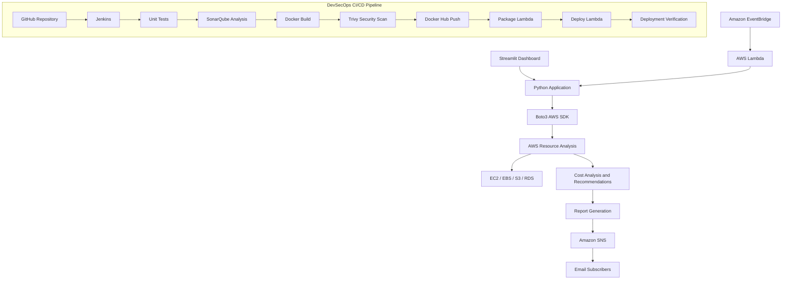

# Intelligent AWS Cost Optimizer with Automated DevSecOps CI/CD Pipeline

An AWS-based cost optimization and monitoring system that analyzes cloud resources, identifies potential cost wastage, generates actionable recommendations, and sends automated reports through email. The project also uses a DevSecOps CI/CD pipeline to test, scan, package, and deploy the application.

## Overview

Managing cloud infrastructure can become expensive when resources are unused or underutilized. This project helps identify such resources and provides recommendations to improve AWS resource utilization and reduce unnecessary costs.

The system uses Python and Boto3 to interact with AWS services, AWS Lambda to execute the analysis, Amazon EventBridge for scheduled execution, and Amazon SNS for email notifications. A Streamlit dashboard provides a visual interface for monitoring resources and viewing recommendations.

**Important:** The system provides recommendations only. It does not automatically stop, delete, or modify AWS resources.

## Key Features

- **AWS Resource Monitoring:** Checks EC2 instances, EBS volumes, EBS snapshots, Elastic IPs, S3 buckets, and RDS instances.
- **Cost Optimization Recommendations:** Identifies potentially underutilized or unused resources.
- **EC2 Utilization Analysis:** Uses CloudWatch CPU metrics to identify instances that may need further utilization review.
- **Cost Anomaly Analysis:** Checks for cost anomalies based on the project's configured analysis logic and available data.
- **Automated Reporting:** Generates reports containing resource summaries, findings, and recommendations.
- **Email Notifications:** Uses Amazon SNS to distribute reports to confirmed email subscribers.
- **Scheduled Execution:** Uses Amazon EventBridge to trigger AWS Lambda automatically.
- **Interactive Dashboard:** Uses Streamlit to display AWS resource information, recommendations, and reports.
- **Demo and Live AWS Modes:** Supports demonstration data as well as live AWS account analysis.
- **DevSecOps Pipeline:** Automates testing, code analysis, container scanning, image publishing, and Lambda deployment.

## Technology Stack

| Category | Technologies |
|---|---|
| Programming Language | Python |
| AWS SDK | Boto3 |
| Cloud Platform | AWS |
| Compute | AWS Lambda, Amazon EC2 |
| Scheduling | Amazon EventBridge |
| Notifications | Amazon SNS |
| Monitoring | Amazon CloudWatch |
| Storage | Amazon S3, Amazon EBS |
| Database Monitoring | Amazon RDS |
| Dashboard | Streamlit |
| CI/CD | Jenkins, GitHub |
| Code Quality | SonarQube |
| Containerization | Docker |
| Security Scanning | Trivy |
| Container Registry | Docker Hub |

## System Architecture



## How the Project Works

### 1. AWS Resource Monitoring

The application uses Boto3 to communicate with AWS APIs and collect information about:

- EC2 instances
- Unattached EBS volumes
- Older EBS snapshots
- Unused Elastic IP addresses
- S3 buckets
- RDS instances

### 2. Cost Optimization Analysis

The Python recommendation engine analyzes collected resource information and identifies possible optimization opportunities.

Examples include:

- EC2 instances with consistently low CPU utilization.
- EBS volumes that are not attached to instances.
- Older snapshots that may need a retention review.
- Elastic IP addresses that are not associated with running resources.

Recommendations should be reviewed before taking action. For example, low CPU utilization alone is not enough to decide that an EC2 instance should be resized.

### 3. Automated Execution with EventBridge and Lambda

Amazon EventBridge triggers the AWS Lambda function according to a configured schedule.

The Lambda function executes the Python analysis, checks AWS resources, and generates the report.

### 4. Email Notifications with SNS

After report generation, the application publishes a notification to an Amazon SNS topic.

Confirmed email subscribers receive the report notification.

### 5. Streamlit Dashboard

The dashboard provides an interface to view:

- AWS account and region information
- Resource summaries
- AWS resource details
- Cost optimization recommendations
- Reports and downloadable files

The dashboard supports Live AWS Mode and Demo Mode.

## DevSecOps CI/CD Pipeline

The project uses Jenkins to automate the application build, security checks, and Lambda deployment.

### Pipeline Stages

| Stage | Description |
|---|---|
| Checkout Code | Retrieves the source code from GitHub. |
| Setup Python | Prepares the Python environment. |
| Run Unit Tests | Executes automated tests. |
| Python Compilation | Checks Python files for compilation errors. |
| SonarQube Scan | Performs static code quality analysis. |
| Docker Build | Builds the application Docker image. |
| Trivy Scan | Scans the image for HIGH and CRITICAL vulnerabilities with available fixes. |
| Push Docker Image | Publishes the image to Docker Hub if the scan passes. |
| Package Lambda | Creates the deployment ZIP package. |
| Deploy Lambda | Updates the AWS Lambda function code. |
| Verify Lambda | Checks that the Lambda deployment is successful and the function is active. |

### CI/CD Workflow

```text
Developer Push
      |
      v
GitHub Repository
      |
      v
Jenkins Pipeline
      |
      v
Unit Tests and Compilation
      |
      v
SonarQube Code Analysis
      |
      v
Docker Image Build
      |
      v
Trivy Security Scan
      |
      v
Docker Hub Push
      |
      v
Lambda ZIP Packaging
      |
      v
AWS Lambda Deployment
      |
      v
Deployment Verification
```

## Project Setup

### Prerequisites

- Python 3.12 or compatible Python version for local development.
- AWS account.
- AWS CLI.
- AWS credentials configured locally.
- Docker.
- Git.
- Required AWS permissions for the resources you want to monitor.

### 1. Clone the Repository

```bash
git clone https://github.com/Riya-te/Intelligent-aws-cost-optimizer.git
cd Intelligent-aws-cost-optimizer
```

### 2. Create a Virtual Environment

Windows:

```bash
python -m venv .venv
.venv\Scripts\activate
```

Linux:

```bash
python3 -m venv .venv
source .venv/bin/activate
```

### 3. Install Dependencies

```bash
pip install -r requirements.txt
```

### 4. Configure AWS Credentials

Configure the AWS CLI:

```bash
aws configure
```

Set your AWS region to:

```text
ap-south-1
```

Verify your AWS identity:

```bash
aws sts get-caller-identity
```

Use an IAM identity with only the permissions required by the application. Never commit AWS access keys or secret credentials to GitHub.

### 5. Run the Dashboard

```bash
python -m streamlit run dashboard/app.py
```

Open the local URL displayed in the terminal, usually:

```text
http://localhost:8501
```

## Docker Usage

Build the Docker image:

```bash
docker build -t aws-cost-optimizer .
```

Run the container:

```bash
docker run -p 8501:8501 aws-cost-optimizer
```

Open the dashboard at `http://localhost:8501`.

## AWS Services Used

| AWS Service | Purpose |
|---|---|
| Amazon EC2 | Monitors virtual machine instances. |
| Amazon EBS | Identifies potentially unused storage volumes. |
| EBS Snapshots | Reviews backup snapshots. |
| Elastic IP | Identifies potentially unused static IP addresses. |
| Amazon S3 | Monitors storage buckets. |
| Amazon RDS | Checks database instances. |
| AWS Lambda | Executes the Python analysis. |
| Amazon EventBridge | Triggers scheduled Lambda executions. |
| Amazon SNS | Sends report notifications through email. |
| Amazon CloudWatch | Provides metrics such as EC2 CPU utilization. |

## Project Structure

```text
Intelligent-aws-cost-optimizer/
│
├── dashboard/
│   └── app.py
│
├── src/
│   └── lambda_function.py
│
├── tests/
│
├── lambda_requirements.txt
├── requirements.txt
├── Dockerfile
├── Jenkinsfile
├── .dockerignore
└── README.md
```

*The structure above highlights the main project files; additional modules and configuration files may also be present.*

## Project Results

The project has been tested with a live AWS account and a working deployment pipeline.

- Successfully connected the dashboard to a live AWS account.
- Retrieved live AWS resource information.
- Generated a cost optimization report.
- Successfully delivered a report notification through Amazon SNS email.
- Executed automated unit tests in Jenkins.
- Completed SonarQube analysis and Trivy image scanning stages.
- Built and pushed the Docker image to Docker Hub.
- Packaged and deployed the Lambda function.
- Verified successful Lambda deployment and active function state.

## Security and Cost Considerations

- The application provides recommendations and does not automatically modify AWS resources.
- AWS credentials should be stored securely and never committed to the repository.
- IAM permissions should follow the principle of least privilege.
- Review AWS resource usage and billing before creating additional infrastructure.
- Review Trivy scan results before deploying container images.
- Restrict access to Jenkins and SonarQube.
- Configure an appropriate EventBridge schedule to avoid unnecessary report notifications.

## Future Enhancements

- Add predictive cost analysis using historical usage data.
- Integrate Amazon SES for customized HTML email reports.
- Add more CloudWatch metrics for better resource utilization analysis.
- Introduce approval-based automated optimization actions.
- Add multi-account AWS monitoring.
- Improve dashboard visualizations and reporting.

## Learning Outcomes

Through this project, I gained practical experience with:

- AWS resource management using Boto3.
- Serverless automation using AWS Lambda.
- Scheduled execution using Amazon EventBridge.
- Notifications using Amazon SNS.
- Cloud monitoring using Amazon CloudWatch.
- Dashboard development using Streamlit.
- CI/CD automation using Jenkins.
- Static code analysis using SonarQube.
- Container security scanning using Trivy.
- Docker image management and AWS Lambda deployment.

## Author

**Riya Kumari**

B.Tech Computer Science and Engineering | 2027 Batch

**Areas of Interest:** AWS Cloud | DevOps | Cloud Automation | DevSecOps

- GitHub: https://github.com/Riya-te
- Portfolio: https://portfolio.riyaa.xyz

---

*This project was developed as a practical implementation of AWS cost monitoring, optimization recommendations, serverless automation, and DevSecOps CI/CD practices.*